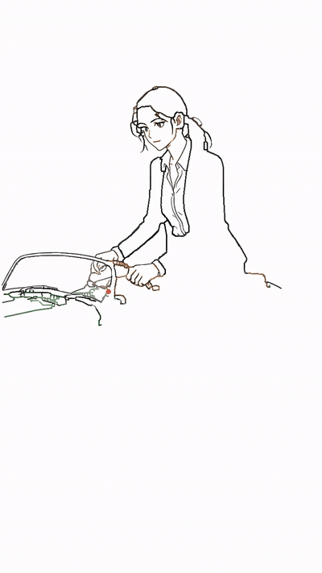

# xm-handdraw-video

[](LICENSE)
[](https://www.python.org/downloads/)
[](SKILL.md)

用自己的画风做逐笔手绘讲解视频。免费生图平台 + 本地渲染，**不用视频生成模型**。

给一段口播稿，它依次完成：分镜 → 配音 → 出图 → 逐笔动画 → 合成，
交付一条带字幕的 MP4。**成片是彩色的**：先逐笔勾出墨线，再用马克笔把色块涂满。




## 和「AI 生成视频」有什么不同

视频生成模型做不出「一笔一笔画出来」的过程——它只会给你一个已经画完的、会动的画面。
而且每次生成的人物、画风都在漂移，同一条片子里前后不像同一个人。

这个项目换了个思路：**画面是静态插画，动画是算出来的**。

1. 先用生图模型出一张张静态插画（画风由配方 + 锚点图锁死）
2. 把插画矢量化成笔画序列，按累积弧长逐帧推进笔尖
3. 颜色不是「画」出来的，是**每个像素记录自己被画到的时刻**，到点直接取原图的颜色

所以画风稳定、人物一致，而且**换画风不用改任何渲染代码**——它只认静态图。

## 开始之前

| 文档 | 用途 |
|---|---|
| [`INSTALL.md`](INSTALL.md) | 换电脑安装：Python、ffmpeg、密钥，五步走 |
| [`COMPATIBILITY.md`](COMPATIBILITY.md) | 在 Claude Code / Codex / Gemini CLI / Cursor 里怎么装 |
| [`SKILL.md`](SKILL.md) | 完整工作流和全部踩坑记录（**主文档**） |
| [`AGENTS.md`](AGENTS.md) | 给认 AGENTS.md 的工具的入口 |
| [`CONTRIBUTING.md`](CONTRIBUTING.md) | 怎么参与：报翻车、加画风、改代码 |

装好后先跑一次自检，它会告诉你缺什么、该敲哪条命令：

```bash
python scripts/doctor.py
```

## 它怎么工作

```
口播稿（或主题）
   ↓
① 分镜     切句 + 模型给每段配画面描述        → storyboard.json
   ↓
② 配音     逐段 Edge TTS，回填真实时长        → audio/*.mp3
   ↓
③ 出图     画风配方 + 锚点图 → 每段一张插画    → shots/*.png   ← 画风在这里决定
   ↓
④ 动画     勾线（骨架化→逐笔）+ 上色（马克笔扫描）→ clips/*.mp4
   ↓
⑤ 合成     拼片段 + 铺音轨 + 烧字幕           → final.mp4
```

三个关键点：

- **画风完全由第 ③ 步的静态图决定。** 第 ④⑤ 步是纯几何与音视频处理，
  换画风不需要改它们。
- **声音决定节奏。** 先拿到每段旁白的真实时长，再决定每段画多久。
  不是先定画面时长再让配音去凑。
- **颜色来自原图，不是画出来的。** 见下节。

## 彩色是怎么来的

渲染不是「用固定颜色重绘笔画」，而是给**每个像素**记录一个「被画到的时刻」，
成片里该像素直接取自原图 —— 所以颜色天然保留。

时序和真人作画一致，先勾线后上色：

```
0 ────────────── 0.55 ── 0.03 ──────────────── 1.0
   逐笔勾出墨线（骨架化 + 追踪）   马克笔把色块逐块涂满（PCA 扫描线）
```

- **勾线**：墨线掩膜 → Zhang-Suen 细化 → 沿方向追踪成折线 → 按弧长推进笔尖
- **上色**：把画面切成网格，每格用 PCA 求出区域主轴，沿垂直方向来回扫描，
  行距约等于笔刷直径，路径加正弦弯曲模拟手写抖动

两条通道共用同一套坐标（`strokes.build_context()` 一次返回原图、墨线掩膜、
笔画序列），否则上色会涂到错位置。

### 为什么背景默认不涂

背景色靠「画面最外一圈的主导色」自动识别（`paint.background_mask()`），
默认跳过，让涂色时间集中在主体上，画面保持「白纸 + 彩色主体」的手绘感。
深色夜景图同样适用——它认的是边缘主导色，不是某个固定颜色值。
想连背景一起涂就加 `--paint-bg`。

另外，浅色背景被跳过时，纸色会自动取背景色而不是纯白 —— 否则「背景一部分被涂、
一部分没涂」会在画面上留下斑驳的边界。

### 相关参数

| 参数 | 默认 | 说明 |
|---|---|---|
| `--mono` | 关 | 退回黑白线稿模式，不做上色 |
| `--ink-ratio` | `0.55` | 勾线占总时长的比例，剩下时间上色 |
| `--tile` | `220` | 上色扫描的网格大小，越小笔触越细 |
| `--paint-bg` | 关 | 连背景一起涂 |

## 快速开始

### 一条命令出成片

```bash
cd xm-handdraw-video

python scripts/xm_handdraw.py build \
  --script 口播稿.txt \
  --style retro-mystery-manga \
  --workdir ./project \
  -o final.mp4
```

它会依次完成分镜、配音、出图、动画、合成，产物结构：

```
project/
├── storyboard.json      分镜（含每段配音时长与时间轴）
├── audio/scene_01.mp3   逐段配音
├── shots/scene_01.png   逐段插画
├── clips/scene_01.mp4   逐段手绘片段
└── final.mp4            成片（字幕已烧录）
```

### 复现上面预览图那套效果

预览图和动图都是这套参数出的——竖版科普、满幅彩色插画、人物形象锁死：

```bash
python scripts/xm_handdraw.py build \
  --storyboard storyboard.json \
  --style handdrawn-explainer \
  --character refs/char-full.png \
  --video-size 720x1280 --paint-bg --margin 0 \
  --voice zh-CN-YunxiNeural --rate "+10%" \
  --workdir . -o final.mp4
```

两个容易漏的点：

- **满幅插画必须同时给 `--paint-bg` 和 `--margin 0`**。不开前者，浅色墙面会被
  `background_mask()` 判成纸底整片跳过（实测覆盖率只剩 47%）；不给后者，
  `_fit()` 的 contain 缩放会留一圈 56px 纸边。两个都开才是 100%
- **`--character` 和 `--anchor` 别混用**。前者锁人物（脸/发型/服装必须复刻），
  后者只继承笔法。想「换画风但人物不变」，要按新画风**重画一张这个人的立绘**
  再传给 `--character`，不能拿另一张现成锚点图顶替——那样人物就换了

### 分步跑（推荐：中间可以人工干预）

```bash
# 1. 切分镜（先看切得对不对）
python scripts/xm_handdraw.py scenes --script 口播稿.txt -o storyboard.json \
       --style retro-mystery-manga

# 2. 手工改 storyboard.json：给每个场景写 subject（画面描述）
#    不写就用旁白原文出图，画面会比较泛。

# 3. 配音，回填真实时长
python scripts/xm_handdraw.py voice --storyboard storyboard.json --workdir ./project

# 4. 全流程（已存在的图会跳过）
python scripts/xm_handdraw.py build --storyboard storyboard.json \
       --style retro-mystery-manga --workdir ./project -o final.mp4
```

### 用自己的图

三种用法，可以混着用：

```bash
# A. 给一张图当「画风锚点」，每个场景都基于它重新出图
python scripts/xm_handdraw.py build --script 口播稿.txt \
  --style retro-mystery-manga --anchor 我的画风样张.png -o final.mp4

# B. 给一张「角色设定图」，画面里出现的人必须长成这张图的样子
python scripts/xm_handdraw.py build --script 口播稿.txt \
  --style handdrawn-explainer --character 角色设定.png -o final.mp4

# C. 直接指定各场景画面，按顺序对应；不足的场景才自动出图
python scripts/xm_handdraw.py build --script 口播稿.txt \
  --style retro-mystery-manga \
  --images 画面1.png 画面2.png 画面3.png -o final.mp4
```

`--anchor` 和 `--character` 都要求生图平台支持图生图（`modelscope`、`agnes`），
但**提示词规则完全相反**：

| 参数 | 提示词要求 | 用在 |
|---|---|---|
| `--anchor` | 只继承笔法、上色、气质，**不要复制**参考图的人物 | 定画风 |
| `--character` | **必须复刻**参考图的脸、发型、服装，只换动作和场景 | 定角色 |

`--character` 会把参考图里的人物身份、发型、着装逐条写进提示词，
并明确要求「不要把参考图的版式、文字、边框画进新画面」——
用户传上来的往往是带排版的人物档案卡，不写这句模型会把整张档案卡当构图参考。

角色设定图建议先裁成**单人全身立绘**再传，四周的表格、说明文字越少越稳。

### 空镜和人物镜可以分开出图

一个片子里不是每个场景都有人。有人物的场景要带 `--character`，
纯物件/场景的空镜不带，否则模型会硬塞一个人进去。
需要精确控制时，逐张 `draw` 再 `build --images` 按顺序串起来最稳。

### 字幕卡（总结页）

想要一张能截图的总结卡，别让生图模型写字——中文小字必糊，还会冒出装饰性假字。
用 PIL 排版生成一张 PNG，再当普通场景塞进 `--images`，手绘动画会按笔画把它「写」出来。

分镜里给这一场加三个字段：

```json
{ "id": "scene_08", "image": "card_summary.png",
  "paint_bg": true, "margin": 0, "subtitle_off": true,
  "rate": "-4%", "hold": 2.2 }
```

| 字段 | 作用 |
|---|---|
| `paint_bg` | 连背景一起涂。浅色块会被量化合并进背景，不涂就只剩空框 |
| `margin` | 留白。满幅卡设 `0`，否则四周会露白边 |
| `subtitle_off` | 不出字幕。画面本身就是字，再压一条字幕反而没法截图 |
| `rate` | 本场语速覆盖，总结句放慢用 |
| `hold` | 本场画完后停留秒数覆盖，给观众留截图时间 |

注意 `hold` 是**从本场时长里扣的**，不是额外加长：`hold` 越大，画得越快。
它只是保证画完之后还剩这么多秒静止。

配色也要避开纸色：纸是米白时，浅蓝浅绿浅橙会和背景一起被当成背景跳过，
所以卡上的色块要选饱和度高一点的。

### 只想把一张图变成手绘动画

```bash
python scripts/xm_handdraw.py animate --image shot.png -o shot.mp4 --duration 8
```

### 看有哪些画风 / 生图平台就绪

```bash
python scripts/xm_handdraw.py styles
python scripts/xm_handdraw.py providers
```

## 环境要求

- Python 3.9+，需要 `Pillow`、`numpy`、`edge-tts`（HTTP 走标准库，不需要 `requests`）
- `ffmpeg`（渲染与合成用）
- 至少一个生图平台的密钥：**如果 Agnes 已经在 WorkBuddy 的模型设置里配过，
  这里会自动复用，无需额外配置**（见 `references/free-providers.md`）

不知道自己的环境缺什么，跑一次自检：

```bash
python scripts/doctor.py
```

它逐项检查 Python 版本、`Pillow`/`numpy`/`edge-tts`、ffmpeg 及其 libass 支持、
字幕字体 family 名、锚点图、生图密钥和目录写权限，**缺哪项直接给对应安装命令**。
十项全绿才算装好。各平台安装路径见 [`COMPATIBILITY.md`](COMPATIBILITY.md)。

### 测试范围：只在 Windows 上验证过

所有出片验证都在 **Windows 11** 上完成。代码做了跨平台处理——ffmpeg 走
`which` 查找（不写死路径）、`subprocess` 统一 UTF-8 编码（防 Windows GBK 解码炸）、
路径用 `os.path.join`——但 **macOS 和 Linux 没有实测过**。

在 macOS / Linux 上大概率能跑。跑不通请提 Issue，那正是最需要的反馈。

### 默认链路完全免费，但不绑定平台

| 环节 | 默认用什么 | 花钱吗 |
|---|---|---|
| 生图 | Agnes / ModelScope / 智谱 Flash | **免费**，有额度限制 |
| 配音 | Edge TTS | **免费**，不需要 Key |
| 渲染合成 | 本地 ffmpeg | **免费**，纯 CPU |

零成本就能出完整成片。但代码没有绑死这几家：

- **生图**：`scripts/providers.py` 是适配器结构，加平台就是加一个类。
  想换成收费的 Midjourney / Flux，或本地部署 SD，只要能返回图片就能接
- **配音**：字幕时间轴来自 TTS 的词级时间戳，换平台时对齐这个接口即可。
  ElevenLabs、Azure、火山这些音质更好的都能换
- 已有收费平台账号的，在 `~/.xm-handdraw/config.json` 里填 key 就能用

**换平台不影响画风和动画**——画风由静态图决定，动画层只认像素。

## 目录

```
xm-handdraw-video/
├── SKILL.md                      ★ 主文档：完整工作流 + 全部踩坑记录
├── AGENTS.md                     给认 AGENTS.md 的 agent（Codex/Cursor/Cline）的入口
├── INSTALL.md                    换电脑安装：五步走
├── COMPATIBILITY.md              各 agent 平台的安装路径与能力边界
├── VERSION                       版本号（唯一真源，代码从这里读）
├── styles/                       ★ 画风配方，一个文件一个画风
│   ├── handdrawn-explainer.md        手绘科普插画（科普默认）
│   ├── digital-flat.md               平滑数码平涂（写实、干净、现代）
│   ├── anime-jp-flat.md              日系动漫平涂（已带锚点图）
│   └── retro-mystery-manga.md        九十年代周刊少年推理漫画
├── assets/
│   ├── anime-jp-flat/anchor.png  画风锚点图（同时是角色立绘）
│   └── fonts/                    抖音美好体 + 许可副本（OFL 1.1）
├── references/
│   ├── style-recipe-spec.md      配方怎么写（五段式规范）
│   ├── prop-library.md           场景道具库（让画面不空）
│   └── free-providers.md         生图平台对比与配置
├── docs/                         README 用的预览图与逐笔动图
├── scripts/
│   ├── xm_handdraw.py            CLI 入口（11 个子命令）
│   ├── providers.py              生图平台适配器
│   ├── recipe.py                 配方解析与提示词渲染
│   ├── scenes.py                 分镜数据结构与切分
│   ├── narration.py              Edge TTS 配音 + 句级时间戳 + 字幕
│   ├── strokes.py                ★ 图片 → 笔画序列（骨架化 + 追踪）
│   ├── paint.py                  ★ 色块 → 马克笔涂抹路径（PCA 扫描线）
│   ├── render.py                 ★ 勾线 + 上色 → 逐帧渲染 → 片段 MP4
│   ├── compose.py                拼接 + 音轨 + 烧字幕 → 成片
│   ├── check_subjects.py         出图前扫画面饱满度（`check` 子命令）
│   └── doctor.py                 环境自检
└── requirements.txt
```

自己做的画风放在 `assets/<画风id>/anchor.png`，`assets/` 里现在只有
`anime-jp-flat` 自带一张，其余画风需要自己生成锚点图。

## 自定义画风

1. 复制 `styles/retro-mystery-manga.md`，改 id 和内容
2. 按 `references/style-recipe-spec.md` 的五段式写
3. 跑 30~50 张抽卡，挑一张最满意的存成 `assets/<id>/anchor.png`
4. 之后每次生图都会自动带上锚点图（`modelscope`、`agnes` 支持）

**配方里不要写艺术家姓名**——模型有过滤，而且名字是弱信号。
把风格拆成线条、五官、比例、背景的可执行描述，再用 NO 约束堵住走样方向。

### 手绘视频的配方要禁掉「会让颜色分层变脏」的填充

成片是彩色的，所以配方**要**有平涂色块。但三类填充必须禁掉：

> 不要网点、不要排线、不要网屏纹理、不要渐变、不要喷枪

原因：上色是把原图量化成几种颜色后逐块涂的。网点会让同一个色块被拆成几十种
灰阶，涂出来又碎又脏；渐变则会让扫描线的路径失去明确边界。

另外**线条要尽量闭合**——上色按线条划分区域，破口的线会让颜色漏到隔壁。
还有一条：背景不要画栏杆、栅栏、书架、窗格这类密集线条的元素，涂色时间
要留给主体。

### 墨线提取的两种模式

`--ink-mode` 三选一，默认 `auto`：

| 模式 | 抓什么 | 适合 |
|---|---|---|
| `dark` | 深色像素（Otsu 阈值） | 线稿、黑白漫画、灰阶插画 |
| `edge` | Sobel 梯度轮廓 | 彩色插画、照片、大块暗部图 |
| `auto` | 有颜色或深色占比 ≥30% → `edge`，其余 → `dark` | 一般情况 |

`auto` 的默认方向是 `dark`，因为 `edge` 遇到网点会失控。出图颜色偏灰阶时
反而更安全。提取效果不对就用 `--ink-mode` 手动指定，`--threshold` 微调。

### 竖屏（9:16）要一起改两处

出图尺寸和成片尺寸都要给，否则会得到「竖图塞进横画布」：

```bash
--size 720x1280 --video-size 720x1280
```

字幕字号是**按画面短边反算**的，不是写死的。原因：libass 把 SRT 当成
PlayResY=288 的脚本，同样的 `FontSize=20` 在 720 高的横屏是 50px，
在 1280 高的竖屏会变成 90px —— 一句话糊掉半屏。现在按「短边 4.8%」算，
横竖两种画幅的视觉大小一致。

字幕还会**按标点重新断句**：一段五六十字的旁白会被切成几屏，
按字数比例分配配音时长，而不是整段压在一条字幕里。

### 实心色块会被自动挖空

黑色大衣、纯黑头发这类大面积纯黑，原样细化会变成一团横七竖八的骨架——
画面上看就是几道粗条纹把人物糊成一团。脚本会自动把色块内部挖空，
只保留外轮廓和所有细线（`--blob-thickness`，默认 `6`，设 `0` 关闭）。

这个值的含义是「厚度超过 2×N 像素的区域算实心块」。默认 6 对 1100px 宽的图
合适：细线完全不受影响，黑块变成干净的轮廓线。线条特别粗的画风可以调大。

### 构图会自动收紧

生成的插画常常留白过多。脚本会按墨迹外接框裁掉空白边，再把外接框**撑回
原图宽高比**，所以效果是「主体放大」而不是「构图变形」。用 `--no-crop` 关闭。

撑回比例这一步很关键：少了它，一个竖长条主体（例如只有人物、没有背景元素）
会被裁成 1:2 的窄条，铺进 16:9 画面时只占中间一小竖条，左右全是空白。

## 配音

配音交给 `xm-tts-voiceover` 技能（Edge TTS，免费，带词级时间戳）。
先拿旁白的实际时长，再定 `--duration`。声音决定节奏，画面适配声音。

## 边界

- 模仿**画风**可以，复制受著作权保护的**具体角色形象**不行
- 免费额度有限且规则会变，用之前先跑 `providers` 确认
- 出图交给第三方平台，本项目不做扩散推理 —— 所以**不需要显卡**，
  一台只有 Python 的机器就能跑（渲染是纯 CPU 的几何与 ffmpeg 活）

## 许可

- 代码：**MIT**，见 [`LICENSE`](LICENSE)。商用、修改、再分发都行，保留版权声明即可
- 字体：抖音美好体按 **SIL OFL 1.1** 随附，见 [`assets/fonts/NOTICE.md`](assets/fonts/NOTICE.md)
- 示例插画（`docs/preview.jpg`、`docs/demo.gif`）：本项目生成，同样 MIT

## 参与

见 [`CONTRIBUTING.md`](CONTRIBUTING.md)。简单说：

- **报翻车**：带上那一场的 `storyboard.json` 片段、出图结果、用的画风 id。
  光说「画错了」没法修——问题九成出在 `subject` 描述不够
- **加画风**：往 `styles/` 放一个 `.md`，按 `references/style-recipe-spec.md` 的五段式写，
  抽卡挑锚点图，PR 里放成片截图
- **改代码**：先 `python scripts/doctor.py` 十项全绿，再 `animate` 出一条 4 秒片段
  验证渲染链没坏（不需要生图密钥）

`CONTRIBUTING.md` 里还列了几个**刻意设计、别当 bug 改**的行为（背景默认不涂、
竖版字幕在 70% 高度、`auto` 墨线偏向 `dark` 等），改之前先看一眼为什么这么定。

## 鸣谢

感谢 [@leo_xiaolei](https://x.com/leo_xiaolei) 的
[sweety-handdraw-video](https://github.com/threerocks/sweety-handdraw-video) 项目。

## 支持与反馈

- 觉得有帮助，给仓库点一个 **Star**
- 生成结果和遇到的问题，欢迎附上**版本号**（`python scripts/xm_handdraw.py --version`）、
  **运行环境**（`python scripts/doctor.py` 的输出）和**可复现片段**，提交
  [Issue](https://github.com/sratour/xm-handdraw-video/issues/new/choose)
- 任何意见可以联络 [@planxyou](https://x.com/planxyou)
