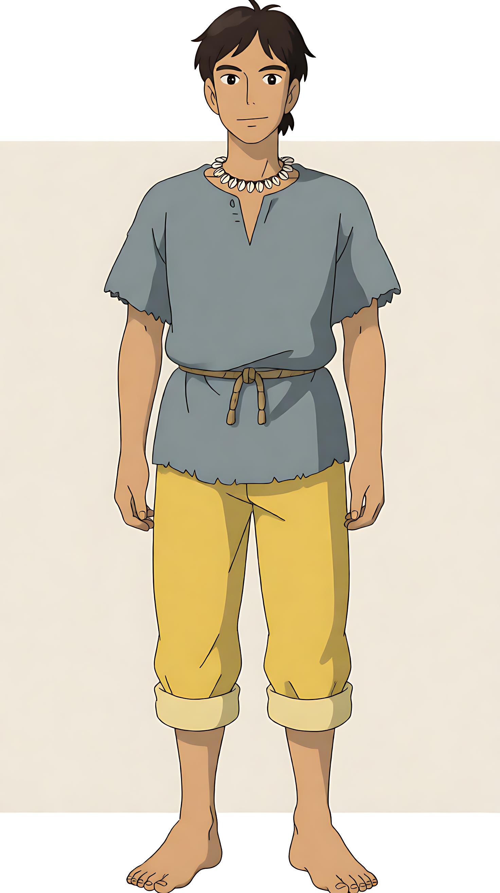

# 老勤 · 沙丁国渔夫



沙丁国系列故事的男主角。第三集《钱，到底是怎么来的》起正式入库。

- **角色 id**：`laoqin`
- **配套画风**：`anime-jp-flat`
- **默认姿态**：`01`（正面站立，唯一的姿态）

---

## 固定特征

| 部位 | 描述 |
|---|---|
| 发型 | 深棕色短发，额前几缕碎发，鬓角短 |
| 眉眼 | 浓眉、单眼皮、眼型偏长 |
| 脸型 | 方圆脸，肤色黝黑，鼻梁挺直 |
| 体型 | 中等身高，肩背结实 |
| 服装 | 灰蓝色粗布短袖（V 领、下摆毛边）+ 土黄色长裤（裤脚卷到小腿）+ 赤脚 |
| 配饰 | 白色小贝壳项链 + 麻绳腰带 |
| 画法 | 日系赛璐璐平涂，细描边，浅米色纸底 |

现成的描述串（`manifest.json` 的 `prompt_fragment`）：

> 一位三十岁上下的东亚男性渔夫，皮肤晒得黝黑，深棕色短发、额前有几缕碎发，
> 浓眉、单眼皮、鼻梁挺直；穿灰蓝色粗布短袖上衣、土黄色长裤裤脚卷到小腿、赤脚；
> 脖子上挂着一串白色小贝壳项链，腰间系着一根麻绳

---

## 怎么调取

```bash
--character laoqin
```

只有一张站姿，所以**动作全靠 subject 写**。他出场的镜头基本都是"在集市/柜台/沙滩上做事"，
写 subject 时把鱼、渔网、竹筐、木桶这些随身道具带上，画面才不会空。

```bash
python scripts/xm_handdraw.py draw --style anime-jp-flat --provider agnes \
  --size 720x1280 --character laoqin \
  --subject "画面里只有老勤一个人：他站在集市摊位前，右手捏着一张浅黄色的钞票举在胸前，眼睛盯着钞票、眉头皱起；身旁的木桌上摆着一条鱼和一个竹筐……" \
  -o shot.png
```

---

## 和 office-lady 的关系

两个角色**不能同时出现在一张图里**——`--character` 只收一张参考图。
需要两人同框时，挑一个当锚点，另一个用文字描述，或者拆成两个镜头。

---

## 加新姿态

```bash
python scripts/char_lib.py extract 新设定图.png --id laoqin --names 02-stand-net,03-carry
python scripts/char_lib.py list
```

切完逐张看，再补 `manifest.json` 的 `poses`。
