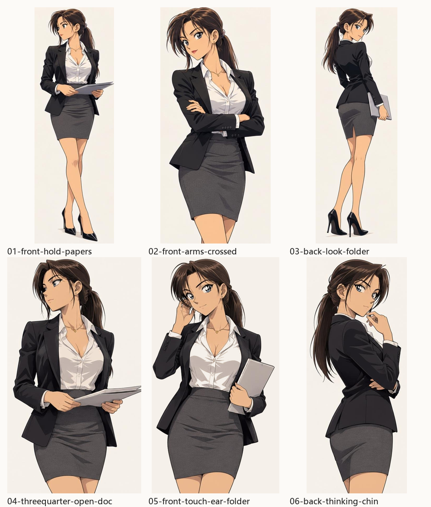

# 职场秘书 · 棕色马尾



日系赛璐璐平涂的职场女性角色，六种姿态。用于口播片里当固定主讲人，
或者当「有人的镜头」里的角色锚点。

- **角色 id**：`office-lady`
- **配套画风**：`anime-jp-flat`（这张角色图本身就是该画风的锚点，画风与人物一起锁住）
- **默认姿态**：`02`（正面抱臂，最像对着镜头说话的一版）

---

## 固定特征

给模型描述这个角色时，这七条不要改，改了就不是同一个人了。

| 部位 | 描述 |
|---|---|
| 发型 | 深棕色长发，脑后扎低马尾，右侧鬓角留一缕垂到锁骨，前额碎刘海 |
| 眼睛 | 蓝色大眼，眼线细、睫毛浓，眉形细长上扬 |
| 脸型 | 鹅蛋脸，下颌收得尖，鼻梁挺直，唇薄浅粉 |
| 体型 | 身高偏高、纤细、长腿 |
| 服装 | 黑色修身单排扣西装外套 + 白色衬衫（敞两粒扣成 V 领）+ 深灰色及膝铅笔裙 + 黑色细高跟鞋 |
| 配饰 | 细金项链，坠子很小 |
| 画法 | 日系赛璐璐平涂，细描边，单层平涂阴影，浅米色纸底 |

现成的描述串（`manifest.json` 的 `prompt_fragment`），直接接在 `subject` 后面：

> 一位二十五六岁的东亚女性，深棕色长发在脑后扎成低马尾、右侧鬓角留一缕长发，
> 蓝色大眼睛，鹅蛋脸尖下颌，戴一条细金项链；穿黑色修身单排扣西装外套、
> 敞开两粒扣的白色衬衫、深灰色及膝铅笔裙、黑色细高跟鞋

---

## 六种姿态

| 序 | 文件 | 视角 | 取景 | 动作 | 适合的镜头 |
|---|---|---|---|---|---|
| 01 | `poses/01-front-hold-papers.png` | 四分之三左前 | 全身 | 双手捧文件，看向左侧 | 开场、念稿、旁听 |
| 02 | `poses/02-front-arms-crossed.png` | 正面 | 七分身 | 抱臂，直视镜头 | 主讲机位、下结论、反问 |
| 03 | `poses/03-back-look-folder.png` | 背面回望 | 全身 | 侧身夹文件夹，回头看 | 转身、带看身后、过渡 |
| 04 | `poses/04-threequarter-open-doc.png` | 四分之三左前 | 七分身 | 翻阅摊开的文件 | 念数据、查资料、核对 |
| 05 | `poses/05-front-touch-ear-folder.png` | 正面 | 七分身 | 整理鬓角，夹文件夹 | 轻松段、打招呼、等答案 |
| 06 | `poses/06-back-thinking-chin.png` | 背面侧转 | 七分身 | 托下巴思考，回望 | 设问、转折、留悬念 |

「全身」的两张含完整高跟鞋，适合站着说话的远景；
「七分身」的四张裁到大腿中部，脸更大、表情更清楚，适合主力镜头。

---

## 怎么调取

```bash
# 默认姿态（02 正面抱臂）
python scripts/xm_handdraw.py draw --style anime-jp-flat \
  --character office-lady \
  --subject "她正面站立……" -o shot.png

# 指定姿态：写序号或文件名前缀都行
--character office-lady:04
--character office-lady:04-threequarter

# 一条龙出片
python scripts/xm_handdraw.py build --script 口播稿.txt --style anime-jp-flat \
  --character office-lady:02
```

也可以直接给路径：`--character assets/char/office-lady/poses/02-front-arms-crossed.png`。

`subject` 里用 `manifest.json` 里对应姿态的 `prompt` 字段，再补场景和道具。

---

## 三条硬规矩

**1. 写死「画面里只有主角一个人」。** 模型会把设定图上的每个姿态都当构图参考，
不写这句，一张图里可能出现两三个主角。实测踩过。

**2. 空镜不要带 `--character`。** 气缸剖面、方向盘特写这类没有人的镜头带上它，
主角会被硬塞进画面，还会把主体画歪。

**3. 场景道具要自己补。** `prompt` 字段只管人物和姿态，不讲环境。
按 SKILL.md「每场都要给够道具」补 2-3 件带位置的道具，
否则出来的就是「一个人站在白墙前」。

---

## 加新姿态

```bash
# 一张横排多姿态的设定图 → 自动切成单张
python scripts/char_lib.py extract 新设定图.png --id office-lady \
  --names 07-side-walk,08-seated

# 看库里现在有什么
python scripts/char_lib.py list
```

切完**逐张打开看**，确认没有把相邻姿态的一角带进来。切多或切少了调 `--gap`
（默认 6，切多了调大；并成一张了调小）。
新增姿态记得补 `manifest.json` 里的 `poses` 和这张表。
